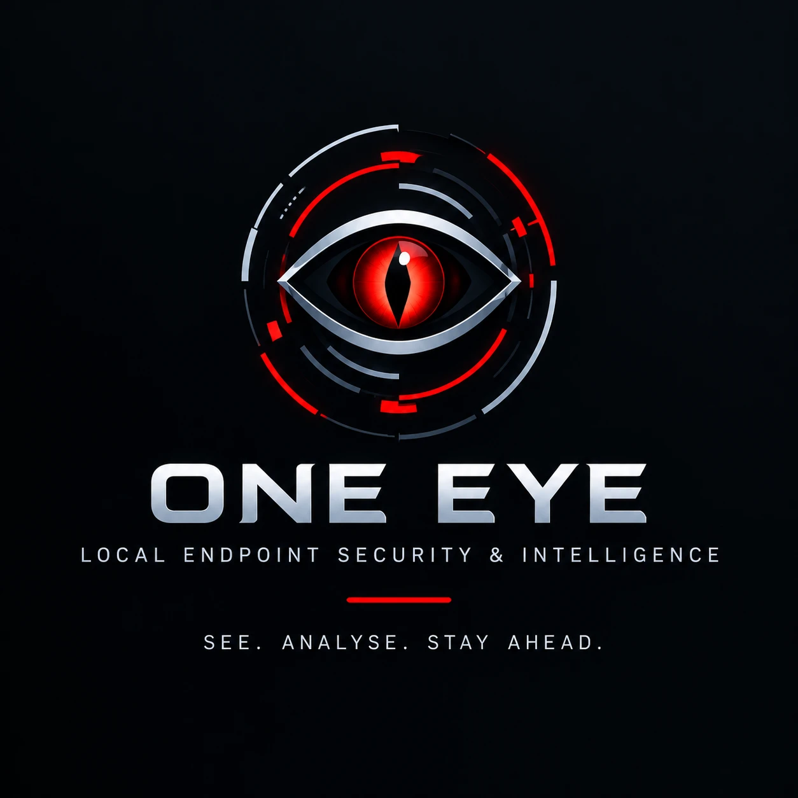
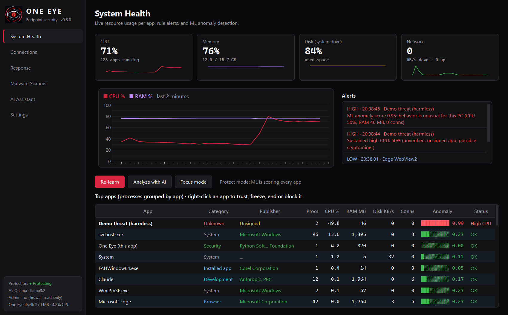
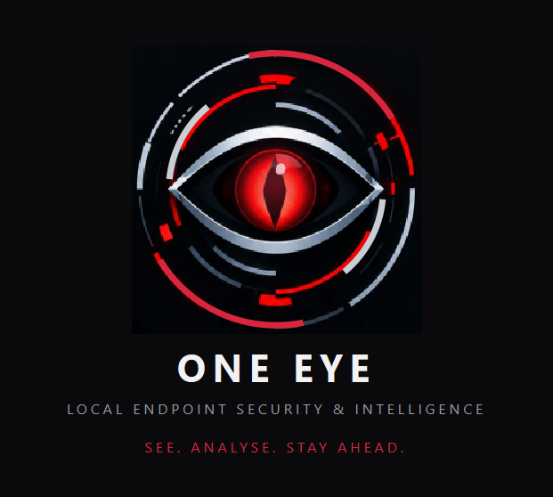
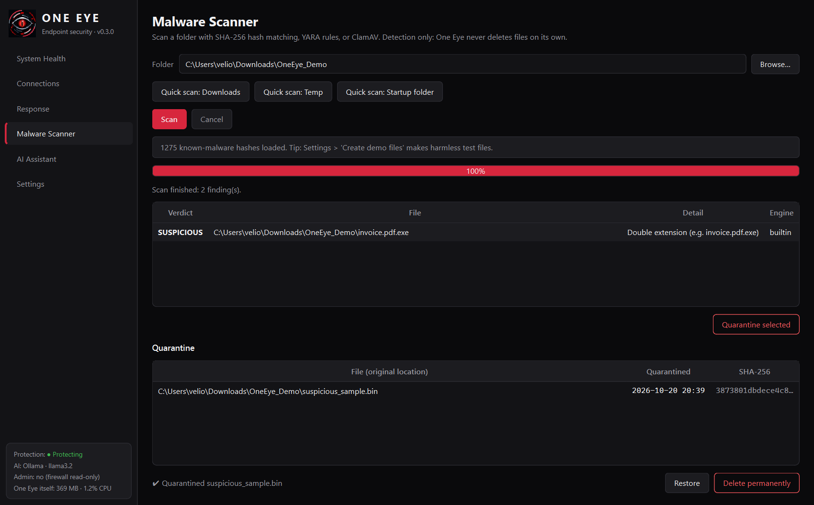
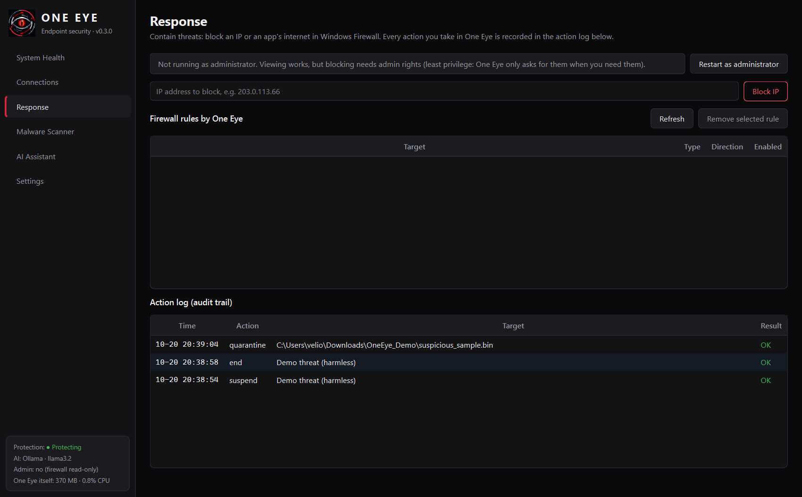
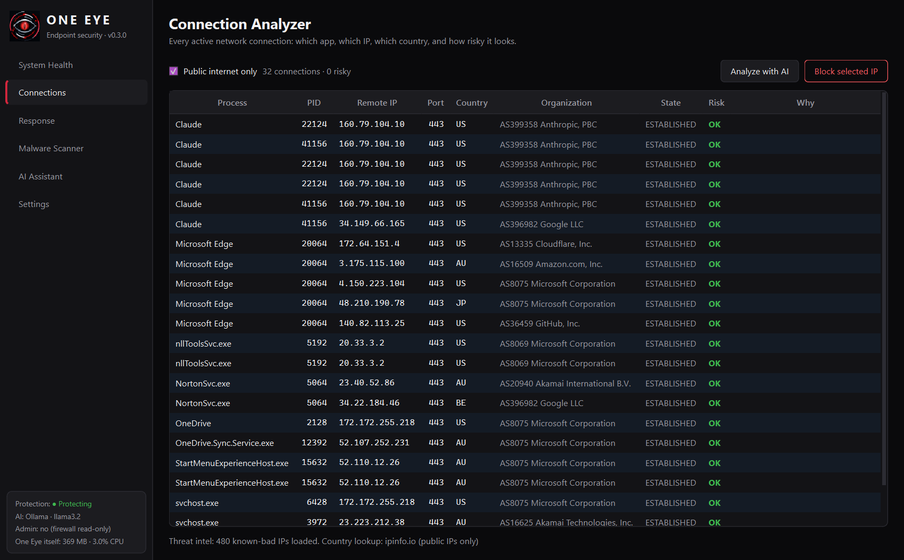

<p align="center"></p>

# One Eye: Local Endpoint Security & Intelligence

**One eye sees all. You stay in control.**
A free, open-source Windows security dashboard: it watches your apps and network, spots unusual
behavior with machine learning, and lets **you** decide what to do. Nothing is changed without your click,
and the AI assistant can only advise.

**▶ Demo video:** ✏️ YouTube link here · **⬇ Download:** see [Releases](../../releases) · **Team & AI use:** [docs/CONTRIBUTIONS.md](docs/CONTRIBUTIONS.md)



| Page | What it does |
|---|---|
| **System Health** | Live CPU/RAM/disk/network, apps grouped (all Chrome processes = 1 row), category, **code-signing publisher**, rule alerts, **ML anomaly detection** (Isolation Forest, per-app baselines), **Focus mode**. Right-click an app: **Trust · Freeze · Resume · End · Block internet** |
| **Connections** | Every connection: app → remote IP → country → risk (threat feeds, suspicious ports, unsigned apps) |
| **Response** | Block an IP or an app's internet in Windows Firewall, and the **action log** (audit trail) |
| **Malware Scanner** | Quick scans (Downloads, Temp, Startup folder) or any folder; SHA-256 + heuristics, YARA, ClamAV. **Quarantine → Restore / Delete** |
| **AI Assistant** | Local AI (Ollama) or Claude explains a *redacted* snapshot. **Advisory only: it cannot change anything** |
| **Settings** | Simple / Advanced mode, privacy, daily threat-list updates, **harmless demo tools** |

## Test it in 5 minutes (no Python needed)

1. Download `OneEye-v0.3.0-win64.zip` from **Releases**, unzip, run `OneEye.exe`.
   SmartScreen may warn because the app isn't code-signed: *More info → Run anyway*.
2. **System Health → Start Learning.** Use the PC normally for 2 minutes until it says *Protect mode*.
3. **Settings → Run demo threat (60 s).** A harmless fake "cryptominer": it only uses CPU, installs nothing,
   and stops by itself. The eye in the sidebar starts pulsing; *Demo threat (harmless)* turns red with
   **High CPU** and **ML anomaly** alerts.
4. Right-click it → **Freeze**, then **End process**. Both appear in **Response → Action log**.
5. **Settings → Create demo files**, **Malware Scanner → Quick scan: Downloads**, select the MALICIOUS file
   → **Quarantine selected**. Then **Restore** or **Delete permanently**. The demo files are harmless.
6. Optional: **Analyze with AI** (needs [Ollama](https://ollama.com) or a Claude API key);
   firewall actions need **Response → Restart as administrator** (try blocking `203.0.113.66`, a reserved test address).

## What One Eye can do about a threat

Following incident response: **contain → investigate → eradicate**, always confirmed by you, always logged.

| Threat | Action | Admin? |
|---|---|---|
| File | **Quarantine** (scrambled so it can't run, reversible) → **Restore** or **Delete permanently** | No |
| Process | **Freeze** (keeps it for investigation) · **Resume** · **End** (with child processes) | No (your apps) |
| Network | **Block IP** (in + out) · **Block an app's internet** | Yes |

Safety rails: core Windows processes and One Eye itself can't be frozen or ended; Windows components can't be
blocked; restore only writes inside your user folder; One Eye only ever removes firewall rules it created.

## How One Eye decides if something is OK

| Signal | Example |
|---|---|
| Threat feeds | Updated daily: abuse.ch Feodo Tracker (botnet servers), Emerging Threats (compromised hosts), MalwareBazaar (new malware hashes). **Downloaded and checked locally: nothing about your PC is sent** |
| Known apps & location | Program Files = installed; Temp / Downloads = suspicious; hidden path = *Protected* (still watched) |
| Code signing | Signed by "Valve Corp." = lower risk; unsigned or "Invalid" (file changed after signing) = higher |
| Behavior (ML) | Each app compared with **its own** normal from Learning mode |
| You | **Trust** (by name **and** path) silences an app's performance/ML alerts; **Focus mode** pauses them while gaming/rendering. Security alerts always stay on |

## Architecture

```
            ┌──────────────────────────── One Eye (one Windows process) ─────────────────────────────┐
 Windows ──►│ Collector (1 NtQuerySystemInformation call/sample) ─► AppGroups ─┬─► RuleEngine ──┐     │
 processes  │ psutil connections ─► ConnectionAnalyzer ◄─ threat feeds        ├─► ML detector ─┼─► Alerts
 & network  │ SignatureCache (Authenticode, background) ─► publisher ──────────┘  (per-app    │     │
            │                                                                       baselines)  │     │
            │ MonitorThread (background, every 2 s) ── Qt signal ──► UI pages ◄──────────────────┘     │
            │                                                                                          │
            │ User clicks only ──► Response: quarantine · freeze/end · firewall rules ──► action log  │
            │ AI Assistant ◄── redacted snapshot (text in, text out; no access to actions)            │
            └──────────────────────────────────────────────────────────────────────────────────────────┘
```

- **`secdash/core/`** is pure logic with no UI, so it can be unit-tested; **`secdash/ui/`** only displays and asks.
- Monitoring runs in a background thread; slow jobs (scans, feeds, firewall, AI) run in a worker pool, so the UI never freezes.
- Data lives in `%APPDATA%\OneEye`: settings (JSON), ML baseline (JSON rows, never pickle), quarantine, action log, feeds.
  API keys go to Windows Credential Manager.

**Why no web deployment:** One Eye has to read *this* PC's processes, files and firewall, which a website cannot
do. So it ships as a Windows app (zip / installer) with the local run instructions below, as the guidelines allow.

## Limitations & future work

- **Not a replacement for antivirus.** Detection is hash lists, heuristics, behavior and ML, with no real-time
  file-system driver; keep Microsoft Defender on. One Eye is a visibility and response layer on top.
- **Windows only.** The process reader, firewall and code-signing checks use Windows APIs.
- **ML needs a learning period** (2+ minutes of normal use) and can still flag a legitimate new app; Trust and
  Focus mode exist for that.
- **Unsigned app:** SmartScreen warns on first run; code signing costs money. The zip is ~114 MB because Qt and
  scikit-learn are bundled.
- **Footprint:** about 240–370 MB RAM (measured; shown live in the sidebar).
- **Action log and quarantine** live in a user-writable folder; a production version would use the Windows Event Log
  and a protected service.
- **Not yet tested end-to-end:** firewall actions (they need admin and a UAC click), the Claude API
  path, ClamAV/YARA plugins, and machines other than the dev laptop.
- **Future:** a background service with real-time protection, startup-item / persistence checks, scheduled
  scans, signed releases, VirusTotal lookups (opt-in, since they send hashes online), and a Linux version.

## Team & AI use

See **[docs/CONTRIBUTIONS.md](docs/CONTRIBUTIONS.md)**: who did what, and how AI assistance was used.

## Run from source

```bat
py -3.13 -m venv .venv
.venv\Scripts\python -m pip install -r requirements.txt
.venv\Scripts\python main.py
```
Tests: `.venv\Scripts\python -m unittest discover tests`. Extra source-only demo:
`.venv\Scripts\python tools\fake_miner.py --from-temp` (also triggers the *suspicious folder* alert).

### Build
```bat
build_exe.bat
powershell Compress-Archive dist\OneEye OneEye-v0.3.0-win64.zip
```
Upload the zip as a GitHub Release asset (`dist/` is git-ignored). Optional installer (Start Menu, uninstaller,
installs to Program Files): `winget install JRSoftware.InnoSetup`, then
`"%LOCALAPPDATA%\Programs\Inno Setup 6\ISCC.exe" installer.iss`.

## More screenshots

| | |
|---|---|
|  |  |
|  |  |

Design decisions and the security reasoning behind them: **[docs/DECISIONS.md](docs/DECISIONS.md)** ·
Demo video script: **[docs/DEMO_SCRIPT.md](docs/DEMO_SCRIPT.md)** · Reporting a vulnerability: **[SECURITY.md](SECURITY.md)**

## Project layout

```
main.py               entry point: splash screen, app, and the harmless --demo-threat mode
secdash/core/         logic, no UI: collector, winproc, categories, rules, anomaly (ML), signature,
                      connections (+ threat feeds), firewall, response (quarantine, process actions, log),
                      scanner, ai, demo, settings
secdash/ui/           PySide6 UI: theme, eye (animated logo), widgets, engine, pages/
assets/               logo, emblem, icon      rules/   hash & IP lists, YARA rules (data, not code)
tests/                unit tests for the risky logic                tools/   fake_miner.py
```

## Credits & licenses

One Eye is MIT-licensed. Third-party components: PySide6 (LGPLv3), pyqtgraph (MIT), psutil (BSD-3),
scikit-learn & numpy (BSD-3), requests (Apache-2.0), keyring (MIT), anthropic SDK (MIT, loaded only if Claude is used).
Threat data: abuse.ch Feodo Tracker & MalwareBazaar (CC0), Emerging Threats compromised-IP list (Proofpoint, free
use), ipinfo.io (country lookup, can be turned off). Optional: Ollama (MIT), yara-python (Apache-2.0), ClamAV (GPLv2).
Versions are pinned in `requirements.txt`; plugins are data or separate engines, never downloaded code.
